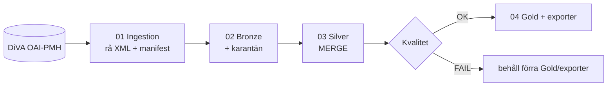

# DiVA Research Lakehouse (Microsoft Fabric)

Ett litet data engineering-projekt som hämtar metadata om studentuppsatser från
[DiVA](https://www.diva-portal.org) via OAI-PMH och bygger ett Bronze → Silver → Gold-lakehouse
med PySpark och Delta Lake i Microsoft Fabric.

**Problemet:** metadata från ett öppet arkiv ändras, raderas och levereras sidvis. Att ladda
den en gång är lätt. Svårare är att göra det **inkrementellt, spårbart och säkert vid
återkörning**: utan dubletter, utan att äldre data skriver över nyare och utan att publicera
resultat som inte klarat kvalitetskontroller.

**Projektet demonstrerar**

* en OAI-PMH-klient: Identify, ListRecords (`oai_dc`), resumptionToken, retries/backoff,
  OAI-fel, `noRecordsMatch` och deleted headers,
* rå XML sparad oförändrad med manifest och SHA-256,
* Bronze med spårbarhet och karantän,
* Silver med deterministisk `content_hash`, deduplicering och Delta `MERGE`
  (nya/ändrade/oförändrade/raderade/inaktuella),
* blockerande kvalitetskontroller före Gold och exporter, samt en körningsrapport,
* en syntetisk återkörningsdemo som verifierar att samma batch två gånger ger samma resultat.

Första versionen hanterar endast metadata: inga PDF:er och inga AI-funktioner.
Standardurvalet är högst 500 poster.



**Teknikstack:** Microsoft Fabric (Lakehouse, Notebooks, Git-integration), PySpark (Fabric
Runtime: Spark 3.5), Delta Lake, Python 3.11 (endast standardbiblioteket i pipelinekoden),
pytest, ruff, GitHub Actions. Inga andra molntjänster.

## Snabbstart i Fabric

Fullständig guide: [docs/setup-fabric.md](docs/setup-fabric.md).

1. Pusha repot till GitHub.
2. Skapa ett Fabric-workspace med kapacitet.
3. Workspace settings → Git integration → GitHub: välj repo, branch och **Git folder `fabric`**.
4. Synka (Update all). Fem notebooks skapas: `00_Run_All`, `01_Ingestion`, `02_Bronze`,
   `03_Silver`, `04_Gold`.
5. Skapa eller välj ett Lakehouse och lägg till det som **default Lakehouse** i `00_Run_All`.
   Koppla samma Lakehouse i 01–04 om du vill köra dem separat.
6. Öppna `00_Run_All` → **Run all**.

Parametrar står i första cellen: `source_mode` (`live`/`demo`), `oai_endpoint`,
`from_datestamp`, `until_datestamp`, `set_spec`, `max_records` (500), `table_prefix`,
`run_id`, `run_mode` (`pipeline`/`rerun_demo`) och `demo_batch`.

Standard är **live** mot `https://www.diva-portal.org/dice/oai` med datestamp-intervallet
**2024-03-01 – 2024-03-02**. Endpointen kunde inte verifieras från byggmiljön, så notebooken
gör alltid `Identify` först och stoppar med ett tydligt fel om den inte svarar.

> **from/until gäller OAI-PMH-datestamp** (när posten skapades eller ändrades i DiVA), inte
> uppsatsens publiceringsår. Publiceringsår tolkas separat från `dc:date`.

### Vad Git synkar och vad som skapas vid körning

| Synkas från Git | Skapas först vid körning |
|---|---|
| 5 notebook-items (`.platform` + `notebook-content.py`) med all kod inbäddad | Delta-tabeller `diva_*` / `diva_demo_*` |
| | `Files/diva/raw/<run_id>/` (rå XML + manifest) |
| | `Files/diva/state/`, `Files/diva/reports/`, `Files/diva/exports/` |

Git-synken installerar inga bibliotek. Det behövs inte heller, eftersom koden bara kräver Fabrics
inbyggda Spark/Delta. Synken skapar och kopplar inget Lakehouse och kör ingenting.

## Tabeller

| Tabell (live-prefix `diva_`) | Korn |
|---|---|
| `diva_bronze_records` | en observation av en post i en körning |
| `diva_bronze_quarantine` | en trasig post eller sida, med felorsak |
| `diva_silver_theses` | aktuell version per `record_id` (inklusive `is_deleted`) |
| `diva_gold_theses_by_year` | publiceringsår |
| `diva_gold_theses_by_university_year` | (lärosätesgrupp, år), där varje post räknas en gång |
| `diva_gold_metadata_completeness` | ett mått (titel, abstract, ämnesord, år, lärosäte) |
| `diva_harvest_log` | ett hämtat intervall per körning (watermark) |

Detaljer finns i [docs/data-dictionary.md](docs/data-dictionary.md) och designen i
[docs/architecture.md](docs/architecture.md).

### Datakällans begränsningar

* Resultaten är ett **begränsat urval**: ett kort datestamp-intervall, högst `max_records` poster
  och en urvalsregel på `dc:type`. De är **inte** statistik över hela DiVA eller Sveriges
  uppsatser, och alla Gold-rader och exporter är märkta så.
* `dc:publisher` behöver inte vara ett lärosäte. Lärosäte härleds med en dokumenterad
  heuristik, och annars blir det "Okänt lärosäte".
* DiVA:s faktiska `dc:type`-vokabulär, set-namn och identifierarformat har inte kunnat
  verifieras från byggmiljön. Manifestet visar de `dc:type`-värden som faktiskt kom in.
* En hämtning som stoppas vid `max_records` markeras som ofullständig och flyttar inte
  watermarken.

## Återkörningsdemo

Sätt `source_mode = "demo"` och `run_mode = "rerun_demo"` i `00_Run_All` och välj Run all.
Demon kör de **syntetiska** batcherna A → B → B igen → samma run_id igen och kontrollerar att
Silver och Gold blir identiska och att inga dubletter uppstår. Se [docs/demo.md](docs/demo.md).

Lokalt:

```bash
pip install -e ".[dev,spark]"          # Java 17+ krävs för Spark
python scripts/run_local_demo.py
```

## Verifiering

```bash
pip install -e ".[dev]"
ruff check src tests scripts
python scripts/build_notebooks.py --check   # genererade notebooks är aktuella
python scripts/verify_notebooks.py          # .platform, logicalId, cellstruktur, ipynb
pytest -m "not spark"                       # rena Python-tester

pip install -e ".[spark]"
pytest -m spark                             # lokal Spark + Delta (MERGE, återkörning, notebook)
```

CI (`.github/workflows/ci.yml`) kör båda grupperna utan Fabric-credentials.

**Status:**

* Verifierat lokalt (Python 3.11, Spark 3.5.3, Delta 3.2.1): alla tester, återkörningsdemon
  och körning av den genererade `00_Run_All` i demoläge.
* **Inte verifierat:** körning i Fabric, att Fabric accepterar de genererade item-filerna vid
  Git-synk, samt den levande DiVA-endpointen.

## Struktur

```
src/diva_lakehouse/   källkod (en enda källa): config, oai_parsing, oai_client, selection,
                      cleaning, storage, ingestion, bronze, silver, quality, gold, pipeline,
                      spark_utils, demo_data (SYNTETISKA fixtures)
scripts/              build_notebooks.py, verify_notebooks.py, run_local_demo.py
fabric/               GENERERADE Fabric notebook-items (Git-synkas)
ipynb/                GENERERADE .ipynb för manuell import
tests/                pytest; tests/spark kräver Spark/Delta; tests/fixtures (syntetiska)
docs/                 setup-fabric, architecture, data-dictionary, demo, portfolio (engelska)
```

Ändra aldrig `fabric/` eller `ipynb/` för hand. Ändra i `src/` och kör `scripts/build_notebooks.py`.
