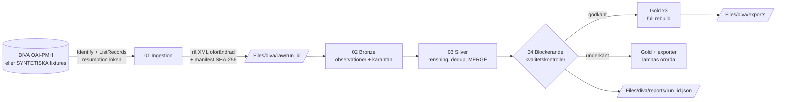

# Arkitektur

## Designval

| Fråga | Val | Varför |
|---|---|---|
| Hur kommer koden in i Fabric? | Varje notebook bäddar in hela paketet `src/diva_lakehouse` som strängar och registrerar det med en liten import-hook. | En katalog med `.py`-filer i GitHub blir inte importerbar i Fabric. Inbäddning kräver varken uppladdning av filer eller ett Fabric Environment. `scripts/build_notebooks.py` är den enda vägen från källkod till notebook och `verify_notebooks.py` + CI kontrollerar att de är aktuella. |
| Beroenden | Endast Pythons standardbibliotek + Fabrics Spark/Delta (`pyspark`, `delta.tables`). | Inget att installera i Fabric. HTTP via `urllib`, XML via `xml.etree`. |
| Filer i Lakehouse | Python-I/O mot `/lakehouse/default/Files/...` | Dokumenterad monteringspunkt för default-Lakehouse i notebooks. Inga workspace-ID eller ABFS-adresser. |
| Tabeller | `saveAsTable("<prefix>_...")` i default-Lakehouse | Inga hårdkodade sökvägar. Live: `diva_*`, demo: `diva_demo_*`. |
| Rensning | Ren Python på drivern (≤ 1000 poster per körning) | Reglerna går att enhetstesta utan Spark. Spark används för Delta, dedup (fönsterfunktion), MERGE, kontroller och aggregat. |
| Tillstånd mellan notebooks | JSON i `Files/<bas>/state/<run_id>/` + pekare `latest_run_id.txt` | 01–04 kan köras i separata sessioner; 00 kör allt i en session. |

## Lager

### Raw (Files)
`Files/diva/raw/<run_id>/page_00001.xml ...` + `manifest.json`. Sidorna sparas byte för byte.
Manifestet innehåller endpoint, Identify-svaret, begärda parametrar, hämtningstid (UTC) per sida,
SHA-256 per fil, antal hämtade/valda/ej valda/raderade/ogiltiga poster, `complete` och `stop_reason`.

Om ett `run_id` redan har ett manifest återanvänds rådata (`reuse_existing_raw=True`): inga nya
anrop, och samma observationer byggs igen.

### Bronze (Delta)
`<prefix>_bronze_records`: en rad per observation av en post i en körning, med källvärden som
arrayer (`dc_title`, `dc_subject`, …), `deleted`, `is_selected` + `selection_reason`,
`raw_file_path`, `raw_file_sha256`, `record_index`, `fetched_at`, `run_id`.
`observation_id = sha256(run_id | raw_file_sha256 | record_index)`. Insert-only MERGE på
`observation_id` gör att samma run_id kan köras om utan dubletter, medan olika körningar
bevarar sina observationer.

`<prefix>_bronze_quarantine`: poster utan identifier/datestamp/metadata och sidor som inte går
att tolka, med `error_reason` och ett XML-utdrag.

### Silver (Delta)
`<prefix>_silver_theses`: aktuell version per `record_id`. Se [data-dictionary](data-dictionary.md)
för fält och regler.

Inkommande batch (Bronze-raderna för körningens `run_id`, valda + deleted) deduplikeras
deterministiskt: nyast `source_datestamp`, sedan nyast `fetched_at`, sedan högst
`raw_file_path`, sedan högst `record_index`. Varje post klassas mot Silver innan MERGE:

| Åtgärd | Villkor | Effekt |
|---|---|---|
| `new` | id saknas, inte deleted | INSERT (`first_seen_*` = `last_changed_*` = observationen) |
| `changed` | `content_hash` skiljer sig | UPDATE affärsfält + spårbarhet + `last_changed_*` |
| `restored` | Silver-raden är raderad, observationen inte | som `changed`, `is_deleted=false` |
| `deleted` | deleted header för aktiv rad | UPDATE `is_deleted=true` + spårbarhet + `last_changed_*` |
| `unchanged` | samma innehåll och raderingsstatus | rör inte raden |
| `stale_ignored` | observationen är äldre än Silver (`source_datestamp`) | rör inte raden |
| `deleted_unknown` | deleted header för id som aldrig setts | rör ingenting (redovisas) |

MERGE-villkoren innehåller dessutom `s.source_datestamp >= t.source_datestamp`, så en äldre
observation kan inte skriva över en nyare även om klassningen skulle vara fel.

`source_datestamp` och `source_*`-fälten beskriver den observation som senast **ändrade**
raden; en senare oförändrad observation uppdaterar dem inte (raden lämnas orörd).

### Gold (Delta, full rebuild)
Byggs från aktiva Silver-rader (`is_deleted = false`). Se kornet i
[data-dictionary](data-dictionary.md#gold).

## Inkrementell hämtning och watermark

* `from_datestamp` / `until_datestamp` filtrerar på OAI-PMH **datestamp** (när posten skapades
  eller ändrades i DiVA), **inte** på uppsatsens publiceringsår. En uppsats från 2015 kan alltså
  komma med i intervallet 2024-03-01–2024-03-02 om dess metadata ändrades då, och en uppsats
  publicerad 2024 kan saknas.
* `harvest_log` (`<prefix>_harvest_log`) sparar varje körnings intervall, `complete` och
  `processed` (Silver-MERGE klar).
* `from_datestamp = "auto"` använder `max(until)` bland körningar som är **både kompletta och
  processade** för samma endpoint och set. En hämtning som stoppats vid `max_records`,
  `max_pages`, OAI-fel eller trasig sida flyttar aldrig watermarken. Gränsdagen begärs igen
  (överlapp), vilket är ofarligt eftersom Bronze och Silver är idempotenta.
* resumptionToken kan inte återupptas mellan körningar (de kan löpa ut). En ofullständig
  hämtning ska därför köras om med kortare intervall eller högre `max_records` (max 1000).

## Kvalitet

Blockerande (stoppar Gold och exporter; tidigare godkända exporter behålls):

* `silver_record_id_unique_not_empty`
* `silver_schema_types`, `bronze_schema_types` (fysiskt schema = deklarerat schema)
* `silver_value_domains` (publiceringsår 1900–2100, hash 64 tecken, `is_deleted` ej null)
* `silver_matches_latest_observation` (Silver = högst prioriterade observationen i hela Bronze,
  dvs. ingen äldre version har ersatt en nyare och inga raderingar har missats)
* `bronze_no_duplicate_observations`
* `gold_*_total_equals_active_silver` (körs på beräknade Gold-data innan de skrivs; raderade
  poster ska vara exkluderade och totalerna ska stämma)

Varningar (rapporteras, stoppar inte): saknat abstract, saknat år, ej identifierat lärosäte,
saknade ämnesord, karantän, bortfiltrerade poster, `stale_ignored`/`deleted_unknown`,
ofullständig hämtning.

Exporter skrivs först till `exports/_staging/<run_id>/` och flyttas sedan på plats.

## Körningsrapport

`Files/<bas>/reports/<run_id>.json`: run_id, läge, start/slut (UTC), status, hämtningens
parametrar/fullständighet/antal, antal accepterade och karantänsatta poster, Silver-ändringar
(nya, ändrade, oförändrade, raderade, inaktuella), kvalitetsresultat och Gold/exporter.
Om samma `run_id` processas igen skrivs rapporten över med den senaste behandlingen.
